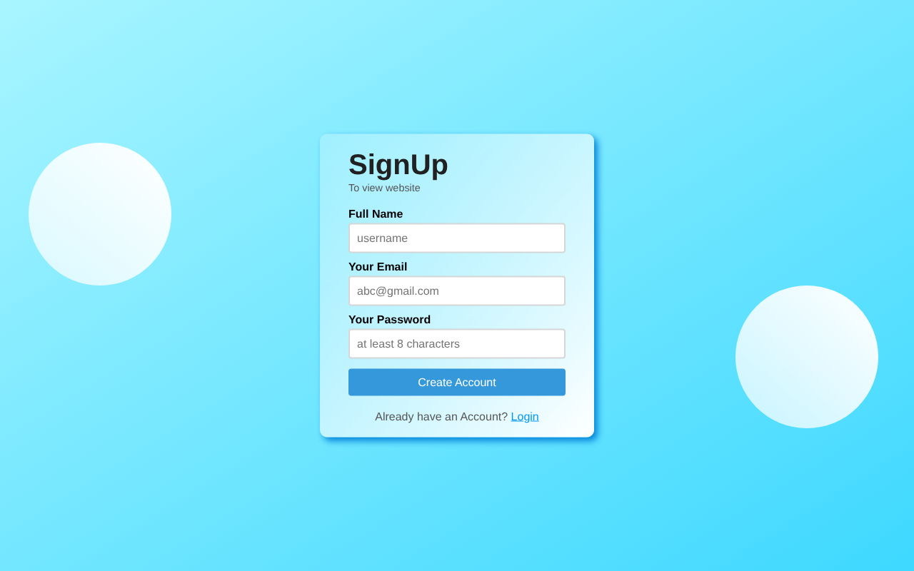

# Sign-Up Page

A responsive sign-up form in HTML and CSS.

## Features

- Name, email and password fields
- Decorative background shapes

## Run it

No build step. Open `index.html` in a browser, or serve the folder with any static server, for example `python -m http.server`.

## Screenshots

